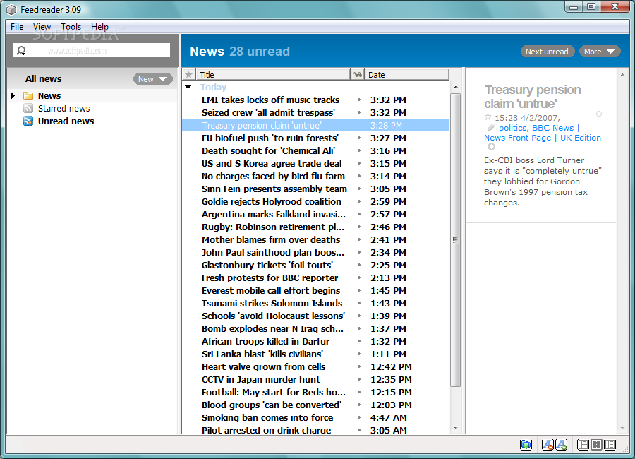
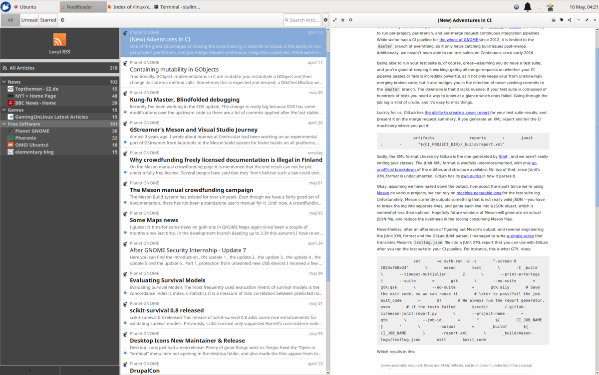

# FeedReader RSS Reader for Organized Desktop Reading

[](https://github.com/FeedReader-news-aggregator/FeedReader-RSS-reader/releases/)

The FeedReader RSS reader provides a desktop interface for reading subscribed sources.
It was designed to work with web-based feed accounts and their synchronised state.
This page describes the archived Linux application maintained in the FeedReader repository.

## Project Status

FeedReader is no longer actively maintained.
Its last published release is v2.11.0 from May 23, 2020.
The repository is archived and preserves the historical implementation.

Existing service integrations must be evaluated against current server behavior.
A backend included in the source is not proof that its present-day service still connects.
Use this distinction when reviewing old screenshots or feature descriptions.

## Reading Workflow

The FeedReader news aggregator separates subscribed sources, article lists and article content.
This structure supports reviewing updates without opening each source in a browser.
An article can still be opened at its original location when needed.

| Reading task | Interface capability | Useful distinction |
| --- | --- | --- |
| Review incoming items | Feed and article lists | Feed selection differs from article selection |
| Track progress | Read and unread states | Synchronisation depends on the selected backend |
| Return to an item | Article marking | A marked item is separate from an unread item |
| Read comfortably | Article themes | Theme settings affect presentation |
| Check the original | Open article in browser | The publisher controls the original page |
| Navigate efficiently | Keyboard shortcuts | Bindings can be reviewed in the shortcuts window |



### Subscription Scope

FeedReader RSS subscriptions belong to the configured local or remote backend.
Before adding or removing a source, identify the active account.
A subscription change and an article-state change are different operations.

### Article Content

Some feeds provide complete text while others provide an excerpt.
The content grabber is an additional mechanism for retrieving article content.
Its results depend on the publisher's page structure and available site rules.

A short article view does not by itself establish a synchronisation failure.
Compare the source feed with the published page before investigating the backend.
Images and linked media can also require separate network requests.

## Backends and Synchronisation

The archived source includes several backend implementations.
Examples include Feedbin, Feedly, Inoreader, FreshRSS and Tiny Tiny RSS.
A local backend and DecSync support are also represented in the source tree.

### Account Compatibility

Authentication methods and remote APIs can change after a client stops receiving updates.
Test the actual account before relying on its reading-state synchronisation.
Record the backend name and server version when investigating a connection problem.

### A Focused Sync Review

1. Confirm which account is active.
2. Refresh the article list.
3. Compare one item's state with the remote account.
4. Check whether the discrepancy affects one source or the entire account.

This approach gives a clearer report than changing multiple settings together.
Separate a server response error from a local article-display problem.

## Requirements

FeedReader is a native GTK application written primarily in Vala and C.
It uses a desktop runtime and backend plugins.
A PHP web server is not required merely to run the local client.

| Component group | Historical project requirement | Role |
| --- | --- | --- |
| Build tools | Meson 0.44.1 or later, Ninja, Vala and a C compiler | Configure and compile the application |
| Desktop interface | GTK 3.22 or later and GLib | Windows, controls and application services |
| Article rendering | WebKitGTK 4.0 API | Display article content |
| HTTP and parsing | libsoup 2.4, libcurl, libxml2, JSON-GLib and Gumbo | Retrieve and process content |
| Local storage | SQLite and libsecret | Article database and secret-service integration |
| Plugins and media | libpeas, GStreamer and GNOME Online Accounts | Optional services and media-related integration |

These are historical dependency names from the archived build definition.
A newer library with a different API name may require source changes.
Resolve dependencies for the selected source revision and distribution.

## Building

The following example assumes a complete FeedReader source checkout.
It uses a separate build directory and a user-owned prefix.
Run it from the source root after providing the required development libraries.

```bash
meson setup builddir --prefix="$HOME/.local" --buildtype=release
ninja -C builddir
meson test -C builddir
ninja -C builddir install
export XDG_DATA_DIRS="$HOME/.local/share:${XDG_DATA_DIRS:-/usr/local/share:/usr/share}"
"$HOME/.local/bin/feedreader"
```

The installation step writes the compiled program and its runtime resources.
The final command launches that installed copy.
The build example has not been executed as part of this documentation.

### Runtime Resource Discovery

A custom prefix must be visible to the desktop data lookup mechanism.
The environment setting above preserves the normal fallback data directories.
It applies to programs launched from the current shell.

An installed application also needs its shared libraries and plugins to be discoverable.
If a custom-prefix launch fails, inspect the loader message before changing application settings.
A missing GSettings schema and a missing shared library are separate failures.

### Build Checks

The archived project defines tests for query-building and string utilities.
Those tests cover specific internal behavior.
They do not certify compatibility with current remote service APIs.

## Command-Line Inspection

FeedReader exposes diagnostic options in its own command-line parser.
The commands below are separate tasks for an existing installation.

```bash
feedreader --version
feedreader --help
feedreader --unreadCount
```

The version output includes the application version and recorded Git revision.
The unread-count option reports a value from the local article database.
It should not be treated as a request to refresh every remote feed.

## Settings and Article Themes

FeedReader stores application preferences through GSettings.
The schema defines refresh timing, article limits and display choices.
These are application settings rather than feed-server configuration.

Use the GLib gsettings tool to inspect the installed schema.
The following commands read settings and the permitted article-theme values.

```bash
gsettings get org.gnome.feedreader sync
gsettings range org.gnome.feedreader article-theme
gsettings get org.gnome.feedreader article-theme
```

The sync value represents minutes between refreshes.
The theme enumeration includes Default, Spring, Midnight, Parchment and Gruvbox.
A theme changes article presentation rather than the content supplied by a publisher.



## Translations

The project uses gettext through Meson's internationalisation support.
Translation work must follow FeedReader's own message catalogues.
Another application's translation target does not update this project.

### Reviewing a Translation

- Preserve placeholders and formatting markers.
- Check the surrounding interface context.
- Distinguish a source title from translated application text.
- Compare long strings with the space available in the window.

Reviewing translations in an archived checkout does not imply upstream review is available.
Any maintained fork should document its own contribution and release process.

## Dependency and Release Review

FeedReader does not use the JavaScript dependency workflow shown by some web aggregators.
Its primary build uses Meson and native libraries.
Apply dependency changes according to the actual build definition.

Keep the complete release identifier when comparing packages.
A distribution rebuild can contain patches beyond the original upstream tag.
Record those package details alongside the selected backend.

## Related Search Terms

FeedReader RSS reader, FeedReader news aggregator, FeedReader Atom reader, FeedReader RSS subscriptions, rss feed reader, feed-reader, rss, atom, feed, gnome, rss-reader, news-aggregator, aggregator, rss-aggregator
